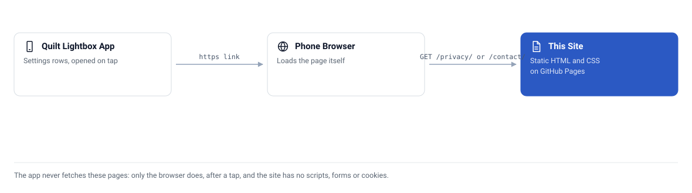

<div align="center">


# 🧵 Quilt Lightbox Site

**The privacy policy and contact page for the Quilt Lightbox app, as plain static pages**


</div>

---

## ✨ Features

| | Feature | What it does |
|---|---|---|
| 🏠 | Home | Says what the app is and its three promises: stays on the device, no account or tracking, free. |
| 🔒 | Privacy policy | Plain-language policy that states only what the app's code does. |
| ✉️ | Contact | One email link with the app's name as the subject, what to include, and common questions. |
| 🌗 | Light and dark | Follows the visitor's system theme and reads at 375 px. |
| 🚫 | Nothing to track you | No scripts, forms, cookies, analytics or web fonts. |

---

## 🗺️ Architecture

<picture>
  <source media="(prefers-color-scheme: dark)" srcset="docs/assets/architecture-dark.svg">
  
</picture>

The app opens these pages only when a person taps a row in Settings. The site itself is three HTML files and one stylesheet.

---

## 🚀 Quick Start

```bash
python3 -m http.server 8000
```

Then open <http://localhost:8000/>. Pushing to `main` publishes the site.

---

## 🔗 Live pages

| Page | URL |
|---|---|
| Home | <https://caputodavide93.github.io/quilt-lightbox-site/> |
| Privacy policy | <https://caputodavide93.github.io/quilt-lightbox-site/privacy/> |
| Contact | <https://caputodavide93.github.io/quilt-lightbox-site/contact/> |

The app links to the last two, so keep these paths and the repository name as they are.

---

## 📁 Repo structure

```text
quilt-lightbox-site/
├── index.html          # 🏠 home page
├── privacy/            # 🔒 privacy policy
├── contact/            # ✉️ contact and common questions
├── assets/             # 🎨 site.css and the app icon
├── docs/assets/        # 🖼️ icon, social preview, architecture diagram
├── tools/              # 🔧 gen_diagram.py
├── AGENTS.md           # 🤖 agent instructions
├── LICENSE  SECURITY.md  llms.txt  .nojekyll
└── README.md
```

---

## 🔒 Security

Report a problem through a [private security advisory](https://github.com/CaputoDavide93/quilt-lightbox-site/security/advisories/new). See [SECURITY.md](SECURITY.md).

---

## 📄 License

[MIT](LICENSE)

---

<p align="center"><sub>Made with ❤️ by <a href="https://github.com/CaputoDavide93">Davide Caputo</a></sub></p>
